# BISI — Batch Image Sequence Importer

**Too busy? Use BISI!**

BISI is a dockable After Effects ScriptUI panel for importing rendered image sequences, arranging shots and AOVs, and replacing existing project footage with new renders.

Version: **0.6.3**. Tested with After Effects 2026 (26.5) on Windows. Other hosts have not been verified. The optional sRGB correction needs AE 26+ color-effect menu APIs.

## Guide

[Install](#install) · [Import: steps 1–5](#import-renders--steps-15) · [Replace: steps 1–5](#replace-project-footage--steps-15) · [Scan filters](#scan-filters-and-saved-settings) · [ACES, sRGB and export](docs/COLOR-WORKFLOW.md)

The screenshots below show the real BISI panel. Private paths are blurred. Click an image to open it at full resolution; example filenames, selections and counts may differ from your project.

## Features

- Scan a render folder recursively; each image sequence appears as one selectable item.
- Show image sequences only by default, or include supported standalone files.
- Import selected renders with shared FPS, alpha and folder-hierarchy settings.
- Create one composition with each shot's AOVs stacked together and shots arranged sequentially.
- Add Cryptomatte to crypto-named EXR sequences when creating a composition.
- Match new renders to existing footage by shot/pass name, ignoring workflow prefixes, versions, dates and frame ranges.
- Review replacements with per-row checkboxes before applying anything.
- Set up an ACES project and show screenshot guides for settings that need manual completion.
- Preserve the appearance of selected, known sRGB timeline layers under the supported ACES SDR view.
- Remember paths, filters and import settings. BISI always opens in **Import** mode.

## Install

1. Download this repository using **Code → Download ZIP**, then extract it.
2. Copy these three files together into your AE installation's `Scripts/ScriptUI Panels` folder:

   ```text
   BISI.jsx
   BISI-ACES-guide.png
   BISI-sRGB-input-guide.png
   ```

   Typical Windows location:

   ```text
   C:\Program Files\Adobe\Adobe After Effects 2026\Support Files\Scripts\ScriptUI Panels
   ```

   Windows may request administrator permission to copy them.
   
3. Restart After Effects and open **Window → BISI**. This is a ScriptUI panel, not an Extensions-menu plug-in. Dock it wherever you prefer.

For a temporary floating session, use **File → Scripts → Run Script File** and choose `BISI.jsx`.

## Import renders — steps 1–5

### Step 1 — Project color

Choose **Default AE (sRGB)** for the default workflow, or **ACES (Redshift)** for the supported ACES workflow. If your project is already correctly configured, leave it unchanged.

[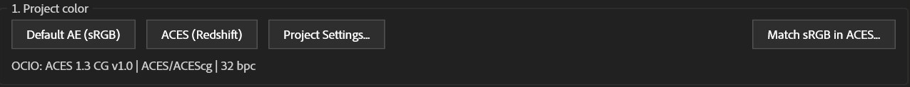](docs/images/01-project-color.png)

Using ACES? Finish the settings shown in the popup: **Project Settings → Color**, **Working Color Space: ACES/ACEScg**, and **Display Color Space: sRGB - Display/ACES 1.0 - SDR Video**. The [color guide](docs/COLOR-WORKFLOW.md) shows the popup and source/export settings.

### Step 2 — Choose a folder, then Scan

1. Select **Import**. Blue indicates the selected mode.
2. Click **Browse**, choose a **Recent** folder, or paste a folder into **Path**.
3. Click the blue **Scan** button.

[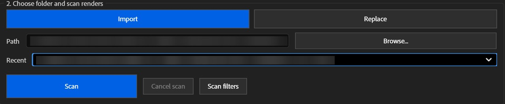](docs/images/02-import-scan.png)

Steps 3–5 stay grey until scanning completes. **Cancel scan** stops a running scan. To change what is scanned, open **Scan filters** before scanning.

### Step 3 — Select the renders

After scanning, each sequence appears as one row, with its frame count, folder and type. The count below the list distinguishes **selected** renders from **found** results.

[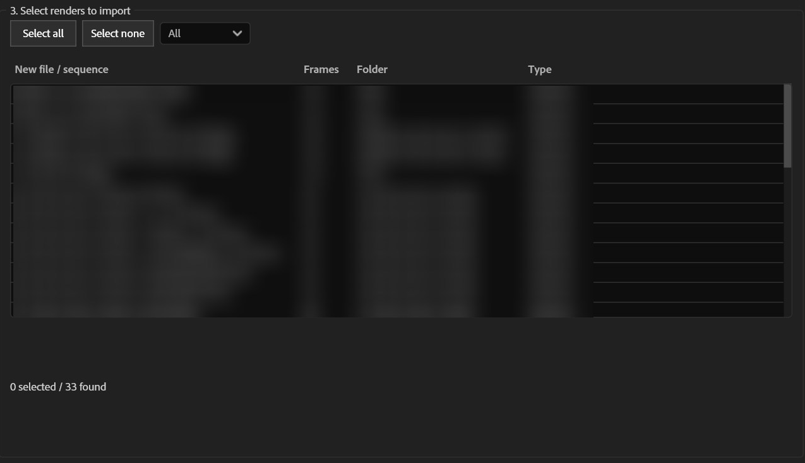](docs/images/03-import-found.png)

Select the rows you want, or use **Select all** / **Select none**. Use the file-type dropdown to show **All**, **exr**, **jpg**, or another scanned type.

[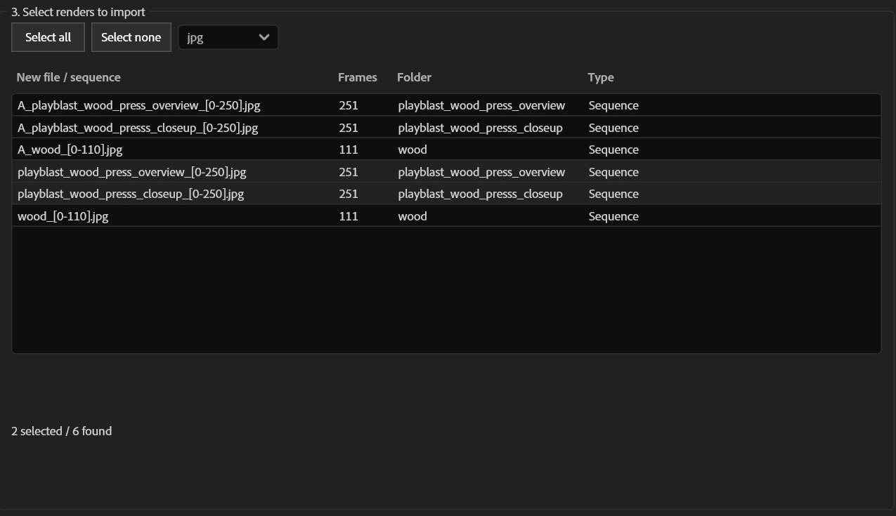](docs/images/04-import-selection.png)

The example shows the list narrowed to JPG sequences. Check your selection count before continuing; nothing has been imported yet.

### Step 4 — Set options for every selected import

[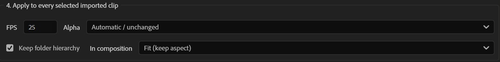](docs/images/05-import-settings.png)

- **FPS:** conform moving video sources, including image sequences; still images are unaffected.
- **Alpha:** Automatic / unchanged, Ignore, Straight or Premultiplied. Premultiplied includes a matte-color setting. See the tested Ignore-alpha limitation below.
- **Keep folder hierarchy:** mirror the scanned folders inside the project. Select an AE project folder before importing to choose a destination.
- **In composition:** Fit keeps aspect ratio and fits inside the frame; Original size keeps 100% scale and can crop larger images. This matters when creating the new composition.

These options apply to **all selected imports**, not just the highlighted row.

### Step 5 — Import

Click one of the blue final buttons:

- **Import:** add the selected footage to the Project panel.
- **Import to new composition:** import the footage and create one composition with grouped AOVs and sequential shots.

[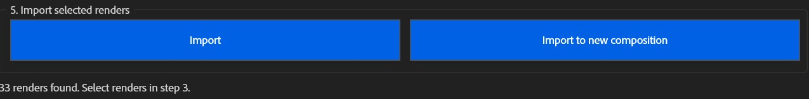](docs/images/06-import-actions.png)

Check the status message after importing. No selection means these buttons remain grey.

<details>
<summary>See the complete Import panel before scanning</summary>

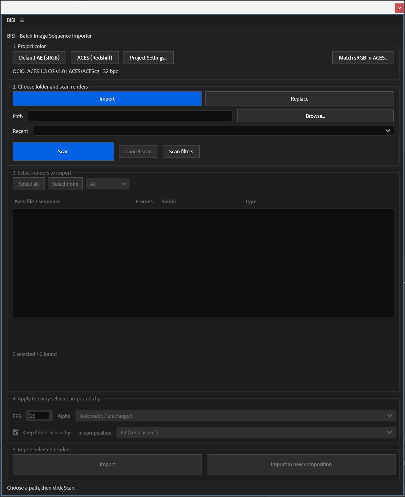

</details>

### Composition arrangement

Import to new composition creates **one shared composition**. Recognized trailing AOV names are grouped by shot. For example:

```text
First shot, stacked at the same time:
  wood_panel_AO
  wood_panel_cryptomaterial
  wood_panel_specular

Next shot, starting after the first group's longest pass:
  wood_press_closeup_AO
  wood_press_closeup_specular
```

Shots sort naturally: `cam01`, `cam02`, then `cam10`. Each pass retains its own duration; the composition extends to the end of all shot groups. Versions, dates and camera IDs remain distinct. Unknown pass suffixes are treated as separate groups. Stills use one second each.

If selected footage has different resolutions, BISI asks for a detected or custom composition size. Cancelling that choice keeps the imported footage but creates no composition. Choose layer blend modes yourself when compositing AOVs.

EXR sequences containing `crypto` in their filename/item name receive the native Cryptomatte effect on newly created composition layers. You still need valid Cryptomatte channels and must choose the desired matte IDs. Ordinary Import and Replace do not add this effect. A missing effect is reported without discarding imported media.

## Replace project footage — steps 1–5

**New renders are on the left. Existing project matches are on the right.**

Save your project before replacing footage.

### Step 1 — Check project color

Use the same project-color controls as Import. Leave a correctly configured project unchanged. Choosing a project preset does not identify the incoming files' color space.

[](docs/images/01-project-color.png)

### Step 2 — Replace mode, folder, Scan

Select **Replace**, choose the folder containing your **new renders**, then click **Scan**. The blue Replace button shows which mode you are in. Browsing alone does not load results.

[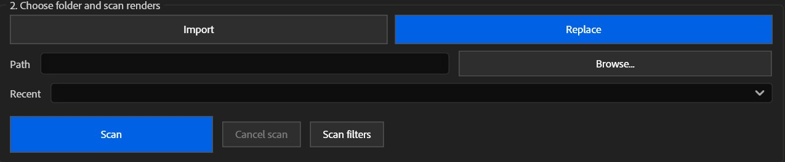](docs/images/07-replace-scan.png)

### Step 3 — Select new renders on the left

Select the incoming renders you want to compare. Use the file-type dropdown or **Select all** / **Select none** as needed.

### Step 4 — Review project matches on the right

The right list updates automatically from your left-side selection. It shows matching footage already in the AE project—not every file on disk. There is no separate Find matches button.

[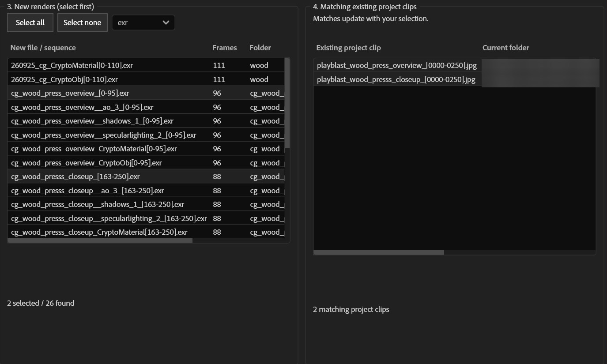](docs/images/08-replace-matches.png)

In this example, `cg_wood_press_overview` and `cg_wood_press_closeup` are candidates for the corresponding `playblast_` project footage. A candidate is a suggestion: review the pair before accepting it.

Click **Compare and confirm…** below both lists.

[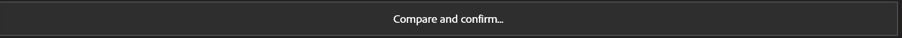](docs/images/09-compare-action.png)

In the dialog:

1. Tick the pairings you want to replace. Unticked pairings are excluded.
2. Click a name to inspect its full paths in **Replacement details**.
3. Click **Confirm replacements**, or **Cancel** to go back without accepting the dialog's changes.

[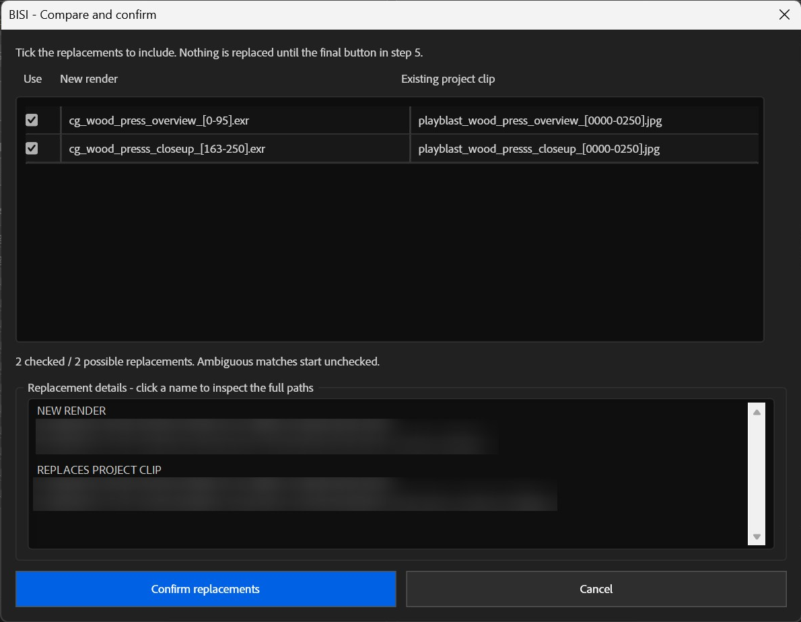](docs/images/10-compare-confirm.png)

Unique matches start checked; ambiguous matches start unchecked. Each source and target can be used only once per batch. **Confirm replacements records your choices; it does not replace footage yet.**

### Step 5 — Apply the checked replacements

Click the blue **Replace project clips** button. This is the step that actually changes the project footage.

[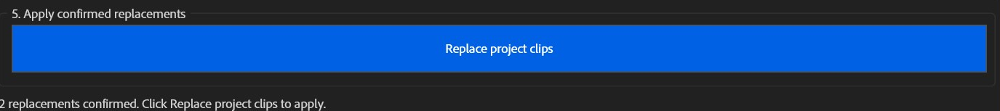](docs/images/11-replace-final.png)

The button stays grey until replacements are confirmed. Changing the source selection/settings invalidates confirmation; compare again before applying.

<details>
<summary>See the complete Replace panel before scanning</summary>

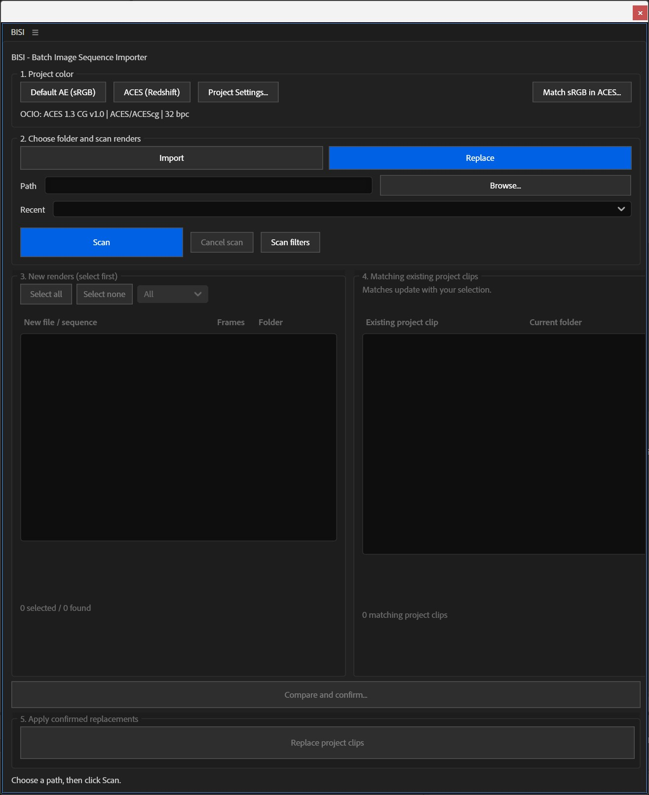

</details>

### How matching works

Example matches:

| Existing footage | New render |
| --- | --- |
| `wood_panel_v1.mov` | `wood_panel_261092_[0-192].exr` |
| `wood_panel_cryptomaterial.exr` | `wood_panel_cryptomaterial_260921_[0-192].exr` |
| `playblast_wood_press_overview_[0000-0250].jpg` | `cg_wood_press_overview_[0-95].exr` |

Matching preserves shot/camera and pass distinctions; it does not indiscriminately pair similar-looking names. The actual source filename and project-item name are matching hints. Already-current sources are excluded. Reselect incoming renders after changing project footage to refresh matches.

Replacement keeps the existing footage item and composition references, and adopts the incoming full name. Moving targets retain their FPS for an incoming sequence; still-to-sequence replacement uses the panel FPS. Existing enabled proxies are switched off, not deleted. Source/settings changes invalidate confirmation. Source durations and dimensions can change, so check the affected compositions afterwards.

## Scan filters and saved settings

**Image sequences only** starts checked. Uncheck it and rescan to include standalone images, movies or other allowed files.

[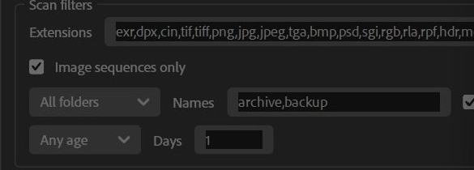](docs/images/13-scan-filters.png)

This is a crop of the expanded filters in the supplied screenshot; the extension list shows that session's saved settings. To change a filter, open **Scan filters**, edit the controls, then click **Scan** again.

Default file endings:

```text
exr,png,jpg,jpeg,tif,tiff,tga,hdr
```

Add supported endings as comma-separated values; leading dots are accepted. Folder Include/Exclude, case sensitivity and Newer/Older age filters are available. A sequence's age uses its newest frame.

Paths/recent folders, filters, FPS, alpha, matte color, hierarchy, sizing, resolution choice and palette size are remembered. **Only the startup mode intentionally resets to Import.** Results must be scanned again; path/filter edits disable steps 3–5 until a new scan completes.

## Color workflows

**Default AE (sRGB)** and **ACES (Redshift)** are project presets, not automatic detection of a source's color space. The ACES button applies supported project settings and opens a guide for remaining manual settings. **Match sRGB in ACES…** works on selected timeline layers, not project-panel footage alone, and requires explicit confirmation of their current interpretation.

See the [color workflow guide](docs/COLOR-WORKFLOW.md) for ACES setup, sRGB appearance matching and AE Render Queue output instructions.

## Safety and known limits

- Save your project before bulk operations. Successful import, replacement and color-correction batches are grouped for Undo; partially completed operations/errors should be reviewed.
- Source media files are never moved, renamed, deleted or rewritten. Project presets never copy, save, close or reload the project.
- In the tested AE build, scripted **Ignore alpha** did not stick. BISI reports this and restores the prior interpretation; set Ignore manually in **Interpret Footage → Main**, or use another alpha mode. Straight and Premultiplied were verified.
- Missing frames are flagged. Duplicate frame numbers and mixed padding are blocked. Multilayer-EXR channel extraction is not included.
- BISI cannot automatically identify a file's true color space, report this host's footage color override, or decide whether an image visually looks wrong.
- Render Queue output color is configured manually. The sRGB appearance workflow is tied to its specified SDR display/output transform, not every ACES view or HDR delivery.

For a bug report, include your AE version, the workflow/step, example filenames and any error text. Remove private project paths from screenshots and examples.
