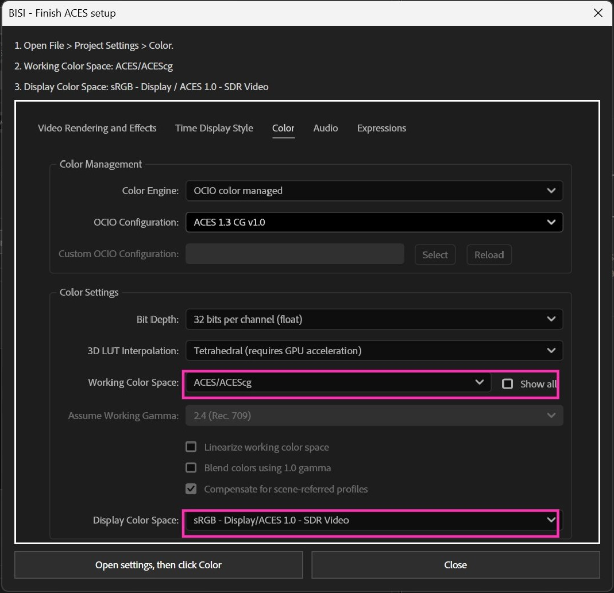
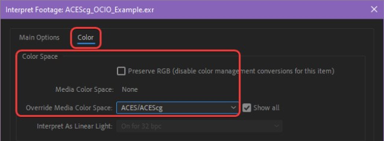
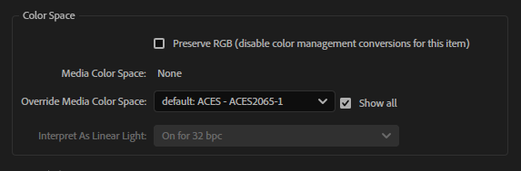
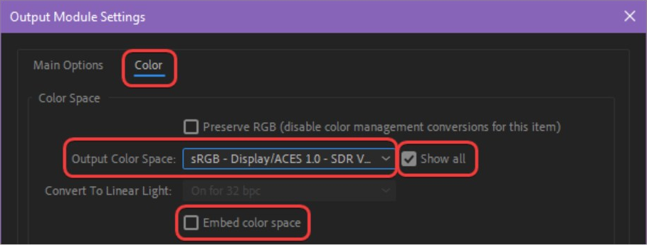

# ACES and sRGB in BISI

These instructions describe BISI's tested **ACES 1.3 CG v1.0 / ACEScg / sRGB SDR** workflow. Choose source interpretation based on how the media was produced, not its filename or extension.

[Back to the Import / Replace walkthrough](../README.md) · [sRGB correction](#3-match-an-existing-srgb-appearance) · [Render Queue export](#4-export-through-ae-render-queue)

## 1. Set up the project

1. Click **ACES (Redshift)**. BISI applies the supported OCIO configuration, 32-bit depth, interpolation and related project flags.
2. Open **Project Settings**, then click **Color**.
3. Check **Working Color Space: ACES/ACEScg**.
4. Check **Display Color Space: sRGB - Display/ACES 1.0 - SDR Video**.

Click **Open settings, then click Color** in the popup. AE may open another Project Settings tab first; select **Color** yourself. Click the screenshot for full resolution, or use the [settings-only reference](../BISI-ACES-guide.png).

The screenshot is a reference. BISI does not use unsupported project-file rewriting or save/reload workarounds. **Default AE (sRGB)** selects Adobe color management, sRGB working space and 32-bit depth instead.

## 2. Check render input

For renders actually produced in ACEScg:

1. In the Project panel, right-click the source.
2. Open **Interpret Footage → Main → Color**.
3. Set/check **Override Media Color Space: ACEScg**, rather than ACES2065-1.

Project working color space does not establish the source encoding. Data passes also need the correct data interpretation; do not assume every EXR is color footage. This source-checking step follows [Maxon's native After Effects ACES workflow](https://help.maxon.net/c4d/en-us/Content/_REDSHIFT_/html/Compositing%2Bwith%2BACES.html).

## 3. Match an existing sRGB appearance

Use this when known sRGB images/video should retain their original displayed appearance while compositing with ACEScg renders. It is not simply an sRGB input tag.

1. Select the relevant footage layers in the active composition timeline.
2. Check their source interpretation in **Interpret Footage → Main → Color**. If sources use different interpretations, handle them in separate batches.
3. Click **Match sRGB in ACES…** at the right of BISI's project-color section.
4. Choose the interpretation currently shown in AE. If there is no override, use Media Color Space. If Preserve RGB is checked, choose **Preserve RGB enabled / Utility/Raw**.
5. Confirm that the listed files are known sRGB and share the chosen interpretation.
6. Click **Apply sRGB correction**.

**Read the current value; do not change it to match this example screenshot.** Cancel the BISI modal if you need to check AE, then reopen it. Unknown and already-matched inputs cannot receive another correction.

The button is disabled outside the supported ACES project context. Project-panel selection alone does not add effects. Eligible sources include PNG, JPEG, PSD and supported image/video footage; extensions do not prove sRGB encoding. EXR/data sources, precomps, locked layers, enabled proxies and existing color-transform effects are excluded.

BISI adds a recovery OCIO Color Space Transform to undo the confirmed input conversion, followed by an inverse OCIO Display Transform for the specified ACES SDR view. Preserve RGB / Raw omits the recovery stage. Existing creative effects stay after the correction. It does not rewrite files, change shared footage interpretation or automatically diagnose incorrect color tagging.

This is intended for the matching view/output below. Later grading, compositing, edge filtering or a different output view can change the appearance. Do not assume camera-log, HDR, P3 or Rec.709 material is sRGB. See [Adobe's OCIO and ACES documentation](https://helpx.adobe.com/after-effects/desktop/adjust-colors/opencolorio-and-aces-color-management/opencolorio-aces-color-management.html) for native transform controls.

## 4. Export through AE Render Queue

For this SDR workflow:

1. Open **Render Queue → Output Module → Color**.
2. Enable **Show All** if needed.
3. Set **Output Color Space: sRGB - Display/ACES 1.0 - SDR Video**, matching the project viewer.
4. For this Maxon SDR recipe, disable **Embed color space**.
5. Do not additionally bake the same forward display transform into the composition.

The input and output settings screenshots above are cropped from the supplied Maxon workflow references; their AE appearance may differ from your version.

BISI does not change output modules. These delivery settings follow [Maxon's SDR output instructions](https://help.maxon.net/c4d/en-us/Content/_REDSHIFT_/html/Compositing%2Bwith%2BACES.html); they are not a scene-linear EXR or HDR export preset.
